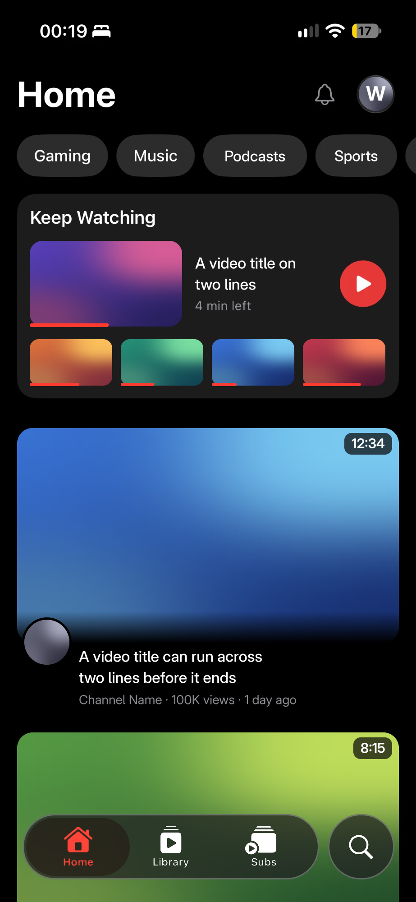
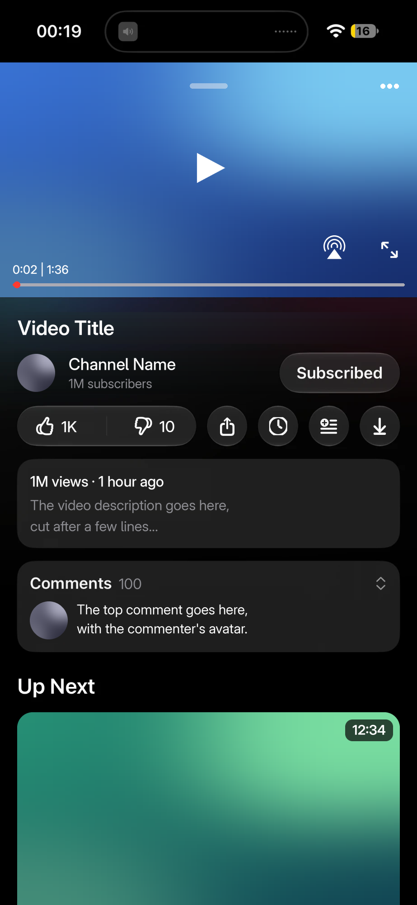
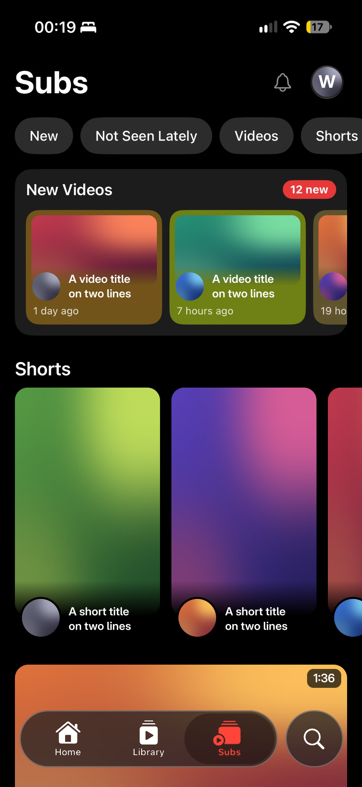

<div align="center">



[](#install)
[](app/WoofTube)
[](https://mpv.io)
[](LICENSE)

**A free, open source YouTube client for iPhone, written from scratch in SwiftUI.**
It contains no YouTube code and shows no ads.

&nbsp;
&nbsp;


<sub>The app's screens, with video content replaced by placeholders.</sub>

</div>

## Highlights

| | |
| --- | --- |
| 🚫 **No ads** | The app plays the video streams directly, so there are no ad breaks or banners. |
| 🎧 **Background and Picture in Picture** | Audio keeps playing when you lock the phone, and the video can float over other apps. |
| ⬇️ **Real downloads** | Videos download in the background and retry when YouTube's address expires. |
| ⏭️ **SponsorBlock** | The seek bar marks sponsors and other segments from the community list, and each kind can skip, show a button or do nothing. Dislike counts come from Return YouTube Dislike. DeArrow can replace clickbait titles and thumbnails. All three are optional. |
| 🧊 **Native iOS 26** | Liquid Glass buttons, zoom transitions, SF Symbols, system menus, tab bar and sheets. Dynamic Type, Dark Mode and Reduce Motion are respected. |

## Features

### Home and Subs
- Your own Home feed, with filter chips and videos you have already seen moved out of the way
- Keep Watching card to resume where you stopped
- New Videos row on Subs: today's uploads as small cards, each in the colour of its cover
- Shorts shelves, community posts with polls, and playlists in the feed
- Long-press menus on videos: Watch Later, playlists, share, download and feedback

### Player
- mpv engine with up to the quality you choose
- Playback speed, captions, audio tracks, chapters and thumbnail previews while seeking
- Live streams with live chat
- Lock screen and Control Center controls, and AirPlay audio
- Miniplayer that floats above the tabs, with light from the video behind it
- Sleep timer and autoplay

### Video page
- Likes, dislike estimates, subscribe, Watch Later, playlists and share
- Comments and replies, with likes
- Up Next, channel pages and search inside a channel

### Shorts
- Vertical swipe through YouTube's own Shorts sequence
- The next Short's address is loaded ahead of the swipe

### Library
- History with search and filters, Watch Later, Liked Videos and your playlists
- Create and edit playlists
- Downloads with quality choice, progress on each row and Cancel All

### Accounts and search
- Google sign-in inside the app, with several accounts, each keeping its own data
- Notification inbox with an unread badge
- Search with suggestions and history, filters for Never Seen and Live videos, and an incognito mode that stops recording it

### Look
- Accent colours that also change the app icon
- Light, dark or system appearance
- Icons with their own animation that follow the real state: the speed needle, the download ring, the sleep timer countdown
- Pages open by growing out of what you tapped

## Speed

- Feeds are parsed away from the main thread, so scrolling doesn't stall while a page loads.
- Home opens on the last saved page while the new one arrives.
- Images are decoded at the size they are shown and held in a memory-limited cache.
- A stream address is reused for 30 minutes, so reopening a video starts at once.

## Privacy

- The app has no analytics and no server of its own. It talks to YouTube directly.
- SponsorBlock and Return YouTube Dislike receive the ID of each video you watch. Turn them off in Settings to stop that.
- DeArrow is off by default. When on, its title list receives part of a code shared by many videos, and its thumbnail server receives the ID of each video with a new thumbnail, also in Incognito.
- Crash reports stay on the phone until you choose to share them from Settings.

## Install

You need iOS 26 or later. This project does not publish IPA files, so you build your own.

1. Fork this repository.
2. Open the **Actions** tab and run the **Native app** workflow.
3. Download the `WoofTube-native` artifact from the finished run. It contains an unsigned `WoofTube.ipa` and expires after one day.
4. Sideload it with a tool that re-signs apps with your Apple ID, such as AltStore, SideStore or Sideloadly.
5. Open WoofTube and sign in.

### Build on a Mac

You need Xcode 26.

```bash
brew install xcodegen
```

```bash
cd app && xcodegen generate && open WoofTube.xcodeproj
```

## Account risk

Google can challenge or restrict an account used in an unofficial app, and posting comments is more visible than watching. Test with a second account.

## Project status

Version 1.0. Each feature still needs testing on more devices. [ROADMAP.md](app/ROADMAP.md) lists what is verified and what is missing.

## Credits

- [SwiftyTube](https://github.com/686udjie/SwiftyTube): Swift client for YouTube's InnerTube API
- [Trop](https://github.com/686udjie/Trop) and [Woof Music](https://github.com/LaskyWolf/WoofMusic): design and code this app is based on
- [mpv](https://mpv.io) and [MPVKit](https://github.com/streamyfin/MPVKit): video playback
- [SponsorBlock](https://sponsor.ajay.app), [DeArrow](https://dearrow.ajay.app) and [Return YouTube Dislike](https://returnyoutubedislike.com): community data

## License

[GPLv3](LICENSE). WoofTube is not affiliated with, endorsed or sponsored by Google or YouTube.
